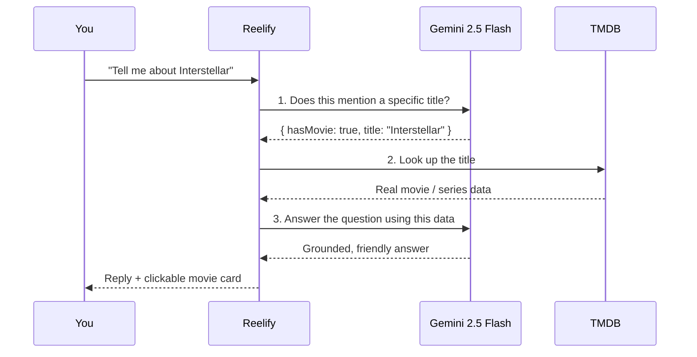

<div align="center">


# 🎬 REELIFY

### _Stop scrolling. Start watching._

A cinematic movie & series discovery app with an **AI movie expert**, a **mood-based picker**, a **one-tap Bollywood mode** and a personal **watchlist**, all running on React and the TMDB API.

<br/>

[](https://reelify-eight.vercel.app)


</div>

---

## ✨ Why Reelify?

Most movie apps show you _everything_. Reelify helps you decide **what to watch tonight**.

| 😩 The problem                          | 🎬 Reelify's answer                                               |
| :-------------------------------------- | :---------------------------------------------------------------- |
| "I don't know what I'm in the mood for" | **Mood Picker**: pick a vibe and a time limit, get a movie        |
| "I have a quick question about a film"  | **Reelify AI**: a Gemini-powered chatbot backed by real TMDB data |
| "I only want Hindi cinema right now"    | **Bollywood Mode**: one toggle re-scopes the whole app            |
| "I'll forget this title by tomorrow"    | **Watchlist**: save movies & series, kept in your browser         |

---

## 🚀 Features

### 🤖 Reelify AI _(floating chatbot)_

Ask anything about movies, series or actors: _"Who directed Sholay?"_, _"Suggest some good Bollywood comedies"_, _"Give me similar series like Mirzapur"_.

It isn't just a raw LLM. Each question runs through a small **retrieve-then-answer pipeline**:



- Bring your own free Gemini key: paste it in the chatbot's settings (stored **only in your browser**), or set it via `.env`
- Offline and network errors are handled with friendly messages

### 🎭 Mood Picker

Pick one of **8 moods** and a runtime limit, and Reelify picks for you.

`😂 Need a laugh` · `😭 Feel something` · `😰 Edge of my seat` · `💥 Adrenaline` · `🤯 Mind-bending` · `🧸 Family night` · `👻 Scare me` · `📚 Based on real life`

Runtime options run from _any length_ to _under 100 min_, with a random "tonight's pick" and paginated results (up to 500 pages).

### 🇮🇳 Bollywood Mode

A single toggle in the navbar switches Home, Web Series and the Mood Picker to **Hindi-language** titles, using TMDB's `with_original_language=hi` with an India region hint. It's global state in React Context, so every page reacts instantly.

### 🔖 Watchlist

Save movies and series from any card. Your list persists in `localStorage`, shows a live **badge counter** on mobile, and only stores the fields it needs to stay tiny.

### 🎞️ Rich Detail Pages

| Page       | What you get                                                                                                   |
| :--------- | :------------------------------------------------------------------------------------------------------------- |
| **Movie**  | Cinematic backdrop, embedded YouTube trailer, top cast, runtime, user reviews, 12 similar titles               |
| **Series** | Season selector with episode lists, **where to watch** (streaming providers for India, falling back to the US) |
| **Actor**  | Biography and a "Known For" grid                                                                               |
| **Home**   | Spotlight hero with trailer + mute control, then Trending, Popular, Top Rated, Now Playing and Upcoming rows   |

### 🔍 Smart Search

Searches **movies and series together**, debounced (400 ms) and with a 3-character minimum so you don't burn API calls mid-typing.

### 📱 Built for phones too

A native-feeling **bottom tab bar** (Home · Series · Mood · Search · Saved) appears on mobile, with safe-area padding for notched devices.

---

## 🎨 Design Language

Dark, glassy and a little neon, inspired by cinema lobbies at night.

|             |                                                                                                              |
| :---------- | :----------------------------------------------------------------------------------------------------------- |
| **Palette** | Ink `#05060A` backgrounds with **neon cyan** `#22D3EE`, **lime** `#A3FF12` and **magenta** `#F472B6` accents |
| **Type**    | _Bebas Neue_ for cinematic headlines, _Manrope_ for body text                                                |
| **Texture** | Glassmorphism panels, film-grain overlay, layered gradient fades on hero banners                             |
| **Motion**  | Fade-in-up animations and a branded loader                                                                   |

---

## 🗺️ Routes

| Path               | Page                                          |
| :----------------- | :-------------------------------------------- |
| `/`                | Home: hero spotlight + curated rows           |
| `/search?q=`       | Movie & series search                         |
| `/movie/:slug-id`  | Movie details (e.g. `/movie/inception-27205`) |
| `/series`          | Web series hub                                |
| `/series/:slug-id` | Series details                                |
| `/actor/:id`       | Actor profile                                 |
| `/mood`            | Mood Picker                                   |
| `/watchlist`       | Your saved titles                             |
| `*`                | Custom 404 page                               |

---

## 🛠️ Tech Stack

| Layer   | Tech                                                     |
| :------ | :------------------------------------------------------- |
| UI      | React `^18.2`                                            |
| Build   | Vite `^7.2` + `@vitejs/plugin-react`                     |
| Styling | Tailwind CSS `^3.4` + custom CSS                         |
| Routing | React Router `^6.30`                                     |
| State   | Context API (`BollywoodContext`, `WatchlistContext`)     |
| HTTP    | Axios (10 s timeout)                                     |
| Icons   | React Icons                                              |
| Data    | [TMDB API](https://www.themoviedb.org/documentation/api) |
| AI      | Google Gemini 2.5 Flash                                  |
| Quality | ESLint 9 + React Hooks rules                             |
| Hosting | Vercel                                                   |

---

## ⚡ Performance, SEO & Accessibility

<details>
<summary><b>⚡ Performance</b></summary>

- **Route-level code splitting** with `React.lazy` and `Suspense` for every page
- Hero image loads `eager` with `fetchpriority="high"` for a faster LCP, while card posters use `loading="lazy"`
- `preconnect` hints to TMDB's API and image CDN
- Static assets under `/assets` are served with `immutable` 1-year cache headers
- Parallel data loading with `Promise.all` on Home
- Stale-response protection (request IDs and `isMounted` guards) so fast filter changes never show outdated results
</details>

<details>
<summary><b>🔎 SEO</b></summary>

- Reusable `<SEO />` component: dynamic titles, descriptions, canonical URLs, Open Graph and Twitter cards on every page
- **Schema.org JSON-LD** (Movie, with cast, rating, runtime and trailer) built only from real TMDB data
- Human-readable slug URLs (`/movie/inception-27205`) that stay backwards-compatible with plain IDs
- `sitemap.xml` and `robots.txt` (private `/watchlist` is disallowed)
- Search-result pages are set to `noindex` to avoid thin-content indexing
</details>

<details>
<summary><b>♿ Accessibility</b></summary>

- Visible keyboard **focus rings** on interactive elements
- ARIA labels on sections and navigation, plus screen-reader-only `<h1>` headings
- Semantic landmarks (`main`, `nav`, `section`)
- Dark `color-scheme` and high-contrast text on glass panels
</details>

<details>
<summary><b>🔒 Security headers</b></summary>

`vercel.json` ships `X-Content-Type-Options: nosniff`, `X-Frame-Options: SAMEORIGIN` and a strict `Referrer-Policy`, plus an SPA rewrite so deep links never 404.

</details>

---

## 📂 Project Structure

```text
reelify/
├── public/                    # Icons, logos, robots.txt, sitemap.xml
├── src/
│   ├── api/
│   │   ├── tmdb.js            # Axios client + all TMDB endpoints
│   │   └── gemini.js          # Gemini title-extraction & chat generation
│   ├── components/
│   │   ├── Navbar.jsx         # Desktop nav, search, Bollywood toggle
│   │   ├── BottomNav.jsx      # Mobile tab bar with watchlist badge
│   │   ├── Hero.jsx           # Spotlight banner with trailer
│   │   ├── MovieCard.jsx      # Poster card + watchlist button
│   │   ├── MovieGrid.jsx      # Responsive grid / rows
│   │   ├── FloatingChatbot.jsx# Reelify AI widget
│   │   ├── SEO.jsx            # Meta tags & JSON-LD injector
│   │   ├── Footer.jsx
│   │   └── Loader.jsx
│   ├── context/
│   │   ├── BollywoodContext.jsx
│   │   └── WatchlistContext.jsx
│   ├── pages/
│   │   ├── Home.jsx           ├── Search.jsx
│   │   ├── MovieDetails.jsx   ├── SeriesDetails.jsx
│   │   ├── WebSeries.jsx      ├── ActorDetails.jsx
│   │   ├── MoodPicker.jsx     ├── Watchlist.jsx
│   │   ├── Chatbot.jsx        └── NotFound.jsx
│   ├── utils/
│   │   ├── slug.js            # SEO-friendly URL helpers
│   │   └── structuredData.js  # Schema.org builders
│   ├── styles/main.css
│   ├── App.jsx                # Routes + lazy loading
│   └── main.jsx               # Providers + router
├── eslint.config.js
├── tailwind.config.js
├── postcss.config.js
├── vite.config.js
├── vercel.json
└── package.json
```

---

## ⚙️ Getting Started

### 1️⃣ Prerequisites

- **Node.js** 18+ (20 LTS recommended) and **npm**
- A free **TMDB API key** → [get one here](https://www.themoviedb.org/settings/api)
- _(Optional)_ A free **Gemini API key** → [Google AI Studio](https://aistudio.google.com/apikey), for the chatbot

### 2️⃣ Install

```bash
git clone https://github.com/I-am-rohitcode/reelify.git
cd reelify
npm install
```

### 3️⃣ Configure environment

Create a `.env` file in the project root:

```env
# Required: movies, series, search, mood picker
VITE_TMDB_API_KEY=your_tmdb_key_here

# Optional: Reelify AI chatbot
# (users can also paste a key in the chatbot's settings instead)
VITE_GEMINI_API_KEY=your_gemini_key_here
```

> 💡 No Gemini key? Everything else works. The chatbot will simply ask visitors to add their own key.

### 4️⃣ Run

```bash
npm run dev
```

Open **http://localhost:5173** 🍿

### 📜 Scripts

| Command           | What it does                 |
| :---------------- | :--------------------------- |
| `npm run dev`     | Dev server with hot reload   |
| `npm run build`   | Production build to `dist/`  |
| `npm run preview` | Preview the production build |
| `npm run lint`    | Lint the codebase            |

---

## ☁️ Deploy to Vercel

1. Push the repo to GitHub
2. Import it at [vercel.com/new](https://vercel.com/new), where the Vite preset is auto-detected
3. Add `VITE_TMDB_API_KEY` (and optionally `VITE_GEMINI_API_KEY`) in **Settings → Environment Variables**
4. Deploy. Every push to `main` ships automatically 🚢

---

## 🔐 A Note on API Keys

Vite bundles every `VITE_*` variable into the browser JavaScript, which means **they are visible to anyone** who inspects the site. That's acceptable for a learning project, but for production:

- Keep `.env` out of git (it's already in `.gitignore`), and **rotate any key that was ever committed**
- Restrict your Gemini key by HTTP referrer in Google AI Studio
- Better still, proxy TMDB and Gemini calls through a serverless function so keys stay on the server

---

## 🧠 What I Learned

- **Async data at scale:** parallel requests, loading and error states, and guarding against race conditions
- **Global state without a library:** Context for the Bollywood filter and a persisted watchlist
- **LLM integration:** a small retrieve-then-answer pipeline that grounds Gemini in real TMDB data
- **Performance engineering:** code splitting, debouncing, lazy images and cache headers
- **Technical SEO in a SPA:** dynamic meta tags, JSON-LD, slugs and sitemaps
- **Responsive, accessible UI:** mobile-first Tailwind, a bottom tab bar, focus management

---

## 🗺️ Roadmap

- [x] Watchlist
- [x] Actor profile pages
- [x] Web series with seasons & episodes
- [x] AI chatbot
- [x] Mood-based discovery
- [x] Pagination (Mood Picker)
- [ ] User authentication with a cloud-synced watchlist
- [ ] Genre filters on Home and Series
- [ ] Pagination for search results
- [ ] Light / dark theme toggle
- [ ] Serverless API proxy for TMDB and Gemini keys
- [ ] Unit & component tests (Vitest + React Testing Library)
- [ ] GitHub Actions CI (lint + build)
- [ ] Optimized image assets and a PWA manifest

---

## 🤝 Contributing

Ideas and PRs are welcome!

```bash
git checkout -b feature/amazing-idea
git commit -m "feat: add amazing idea"
git push origin feature/amazing-idea
```

Then open a Pull Request. Please run `npm run lint` first.

---

## 👨‍💻 Author

<div align="center">

**Rohit Kumar Prasad** · BCA Student · React Developer

[](https://github.com/I-am-rohitcode)

_If Reelify helped you pick tonight's movie, drop a ⭐ on the repo!_

</div>

---

## 📄 License & Attribution

Built for educational purposes.

_This product uses the TMDB API but is not endorsed or certified by TMDB._
